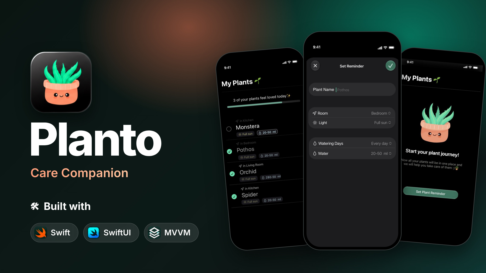

# 🌱 MyPlants

MyPlants is a simple and friendly plant-care app that helps users organize their plants and keep track of their watering routines. Users can create plant reminders, manage their plant care details, and mark watering tasks as completed.

## ✨ Main Features

- Add new plants and create watering reminders.
- Edit existing plant information and reminders.
- Delete plant reminders.
- Organize plants by room.
- Specify light conditions for each plant.
- Set watering frequency and water amount.
- Mark plants as watered/completed.
- Track daily plant-care progress.
- Receive watering notifications.
- Save plant reminders locally.

## 🛠 Technologies Used

- Swift
- SwiftUI
- UserNotifications
- Codable
- Local Storage

## 📱 App Preview

